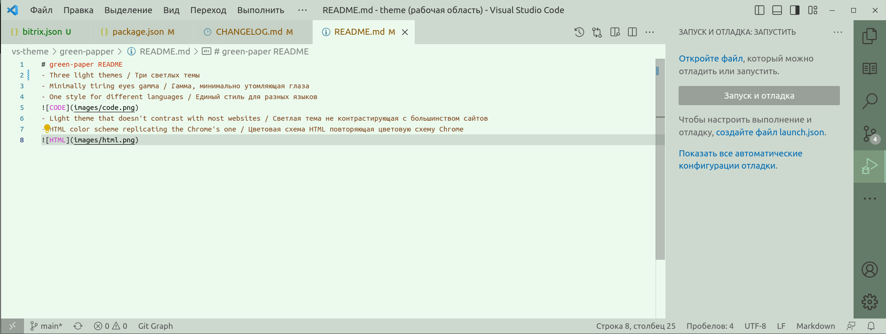
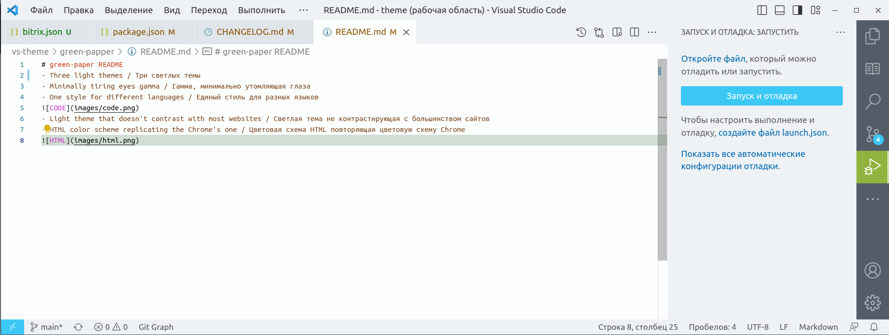
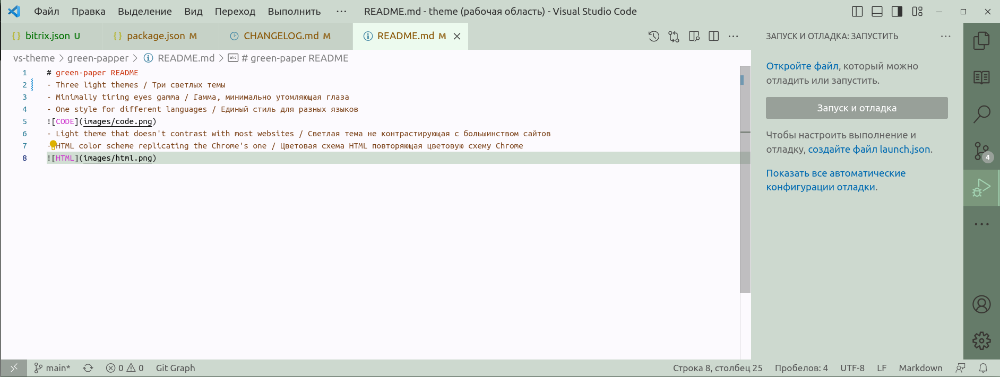
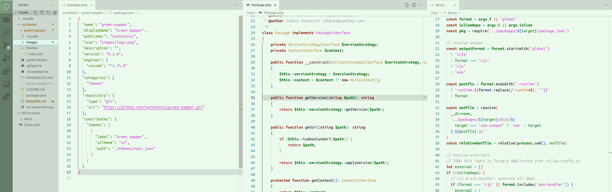
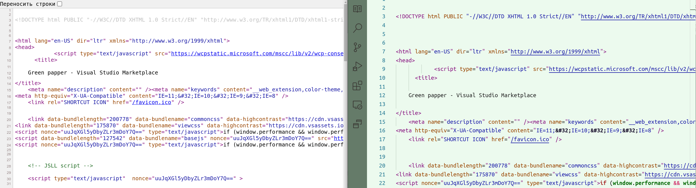

# Green Papper

Набор цветовых тем для Visual Studio Code с мягкой зелёной гаммой и единым стилем подсветки кода.

A collection of Visual Studio Code themes with a soft green palette and a consistent code-highlighting style.

## Темы / Themes

В расширение входят девять вариантов:

The extension includes nine variants:

- **Green paper** — основная зелёная тема / the main green theme
- **Green Chrome** — зелёная тема в стиле Chrome / a Chrome-inspired green theme
- **Green Chrome: base** — базовый вариант Green Chrome / the base Green Chrome variant
- **Green Chrome Dark** — тёмный вариант Green Chrome / the dark Green Chrome variant
- **Green Chrome Dark: base** — тёмный базовый вариант Green Chrome / the dark base Green Chrome variant
- **Vert Guignet Chrome** — тёплая Chrome-палитра / a warm Chrome-inspired palette
- **Vert Guignet Chrome Dark** — тёмный вариант Vert Guignet Chrome / the dark Vert Guignet Chrome variant
- **Green paper white** — светлый нейтральный вариант / a light neutral variant
- **Green paper bitrix** — вариант для работы с Bitrix / a Bitrix-oriented variant

Большинство вариантов рассчитано на светлый интерфейс VS Code; для тёмного интерфейса предназначены **Green Chrome Dark**, **Green Chrome Dark: base** и **Vert Guignet Chrome Dark**.

Most variants are designed for the light VS Code interface; **Green Chrome Dark**, **Green Chrome Dark: base** and **Vert Guignet Chrome Dark** are designed for the dark interface.





## Особенности / Features

- Мягкая цветовая гамма, рассчитанная на длительную работу / a soft palette for extended work sessions
- Единый стиль подсветки для разных языков / consistent highlighting across languages
- Поддержка современных областей интерфейса VS Code: sticky scroll, inlay hints, minimap, peek view, Git, notebooks и Chat / support for modern VS Code UI areas including sticky scroll, inlay hints, minimap, peek view, Git, notebooks and Chat
- Отдельная терминальная палитра с различимыми ANSI-цветами / a dedicated terminal palette with distinguishable ANSI colors
- HTML-подсветка в стиле Chrome / Chrome-inspired HTML highlighting



Светлые темы не создают резкого контраста с большинством веб-сайтов, а тёмный вариант снижает нагрузку на глаза при работе в тёмном интерфейсе.

The light themes avoid harsh contrast with most websites, while the dark variant reduces eye strain when working with a dark interface.



## Obsidian / Obsidian

Одноимённые темы для Obsidian лежат в каталоге `sub/obsidian/`. Скопируйте нужные папки в `<vault>/.obsidian/themes/` и выберите тему в настройках внешнего вида.

The matching Obsidian themes live in `sub/obsidian/`. Copy the folders you need to `<vault>/.obsidian/themes/` and pick the theme in the Appearance settings.

- **GreenPapper** — для темы Green paper / for the Green paper theme
- **GreenChrome** — для темы Green Chrome / for the Green Chrome theme
- **GreenChromeBase** — для темы Green Chrome: base / for the Green Chrome: base theme
- **GreenChromeDark** — для темы Green Chrome Dark / for the Green Chrome Dark theme
- **GreenChromeDarkBase** — для темы Green Chrome Dark: base / for the Green Chrome Dark: base theme
- **VertGuignetChrome** — для темы Vert Guignet Chrome / for the Vert Guignet Chrome theme
- **VertGuignetChromeDark** — для темы Vert Guignet Chrome Dark / for the Vert Guignet Chrome Dark theme
- **GreenPapperWhite** — для темы Green paper white / for the Green paper white theme
- **GreenPapperBitrix** — для темы Green paper bitrix / for the Green paper bitrix theme

## Guake / Guake

Палитры для терминала Guake лежат в `sub/guake/palettes.md`, а скрипт `sub/guake/patch-palettes.sh` переносит их в файл палитр Guake:

The Guake terminal palettes live in `sub/guake/palettes.md`, and `sub/guake/patch-palettes.sh` copies them into the Guake palette file:

```bash
sudo ./sub/guake/patch-palettes.sh        # патч /usr/lib/python3/dist-packages/guake/palettes.py
sudo ./sub/guake/patch-palettes.sh -n     # только diff, без записи
```

Скрипт заменяет записи с теми же именами, удаляет устаревшие дубликаты и добавляет отсутствующие палитры. После установки перезапустите Guake: палитры появятся в Preferences → Appearance → Palette.

The script replaces entries with the same names, removes stale duplicates and adds missing palettes. Restart Guake afterwards: the palettes appear in Preferences → Appearance → Palette.

## Micro / Micro

Цветовые схемы для редактора [micro](https://micro-editor.github.io/) лежат в `sub/micro/` и сгенерированы из тем VS Code в `themes/*.json`. Для каждой из девяти тем есть файл `.micro` с тем же названием, что и у темы VS Code (например, `green-papper.micro`, `green-chrome-dark.micro`).

The micro colorschemes live in `sub/micro/` and are generated from the VS Code themes in `themes/*.json`. Each of the nine themes has a `.micro` file named after it (for example `green-papper.micro`, `green-chrome-dark.micro`).

```bash
mkdir -p ~/.config/micro/colorschemes
cp sub/micro/*.micro ~/.config/micro/colorschemes/
```

Выберите схему в `~/.config/micro/settings.json`, например `"colorscheme": "green-papper"`, или через команду `set colorscheme green-papper` внутри micro.

Select a scheme in `~/.config/micro/settings.json`, for example `"colorscheme": "green-papper"`, or run `set colorscheme green-papper` inside micro.

После изменения тем в `themes/` пересоздайте схемы: `python3 sub/micro/generate-colorschemes.py`.

After changing the themes in `themes/`, regenerate the schemes with `python3 sub/micro/generate-colorschemes.py`.

## OpenCode / OpenCode

Светлая тема OpenCode на базе **Green Chrome** лежит в `sub/opencode/green-chrome.json`. Скопируйте файл в каталог пользовательских тем:

The light OpenCode theme based on **Green Chrome** lives in `sub/opencode/green-chrome.json`. Copy it to the global themes directory:

```bash
mkdir -p ~/.config/opencode/themes
cp sub/opencode/green-chrome.json ~/.config/opencode/themes/green-chrome.json
```

Затем выберите `green-chrome` в настройках темы OpenCode или задайте её в `~/.config/opencode/cli.json`:

Then select `green-chrome` in the OpenCode theme settings or set it in `~/.config/opencode/cli.json`:

```json
{
  "theme": {
    "name": "green-chrome",
    "mode": "light"
  }
}
```

## OpenCode GUI / OpenCode GUI

Для настольного приложения OpenCode используется отдельный формат Desktop Theme. Файл темы находится в `sub/opencode/green-chrome-desktop.json` и содержит светлый и тёмный варианты.

Текущая версия GUI загружает пользовательские темы через GUI-плагин, а не просто читает файлы из `~/.config/opencode/themes/`. Схема должна соответствовать `https://opencode.ai/desktop-theme.json`; тему можно зарегистрировать плагином через `ctx.add(Theme, theme)` и выбрать в Settings → Appearance → Theme.

The desktop app uses a separate Desktop Theme format. The theme is in `sub/opencode/green-chrome-desktop.json` with both light and dark variants.

The current GUI loads custom themes through a GUI plugin rather than directly from `~/.config/opencode/themes/`. The file must follow `https://opencode.ai/desktop-theme.json`; a plugin registers it with `ctx.add(Theme, theme)` and makes it available under Settings → Appearance → Theme.

Готовый пример регистрации находится в `sub/opencode/green-chrome-plugin/`. Соберите и подключите его локально:

A registration example is provided in `sub/opencode/green-chrome-plugin/`. Build and connect it as a local plugin:

```bash
cd sub/opencode/green-chrome-plugin
npm install
npm run build
```

Добавьте абсолютный путь к каталогу плагина в `~/.config/opencode/opencode.jsonc`:

Add the plugin directory's absolute path to `~/.config/opencode/opencode.jsonc`:

```jsonc
{
  "plugins": [
    "/absolute/path/to/green-papper/sub/opencode/green-chrome-plugin"
  ]
}
```

Перезапустите OpenCode Desktop. Тема появится в `Settings → Appearance → Theme` под названием **Green Chrome**.

## Установка / Installation

Установите расширение Green Papper в VS Code, затем откройте палитру команд (`Ctrl+Shift+P`) и выберите `Preferences: Color Theme`.

Install the Green Papper extension in VS Code, then open the Command Palette (`Ctrl+Shift+P`) and choose `Preferences: Color Theme`.
